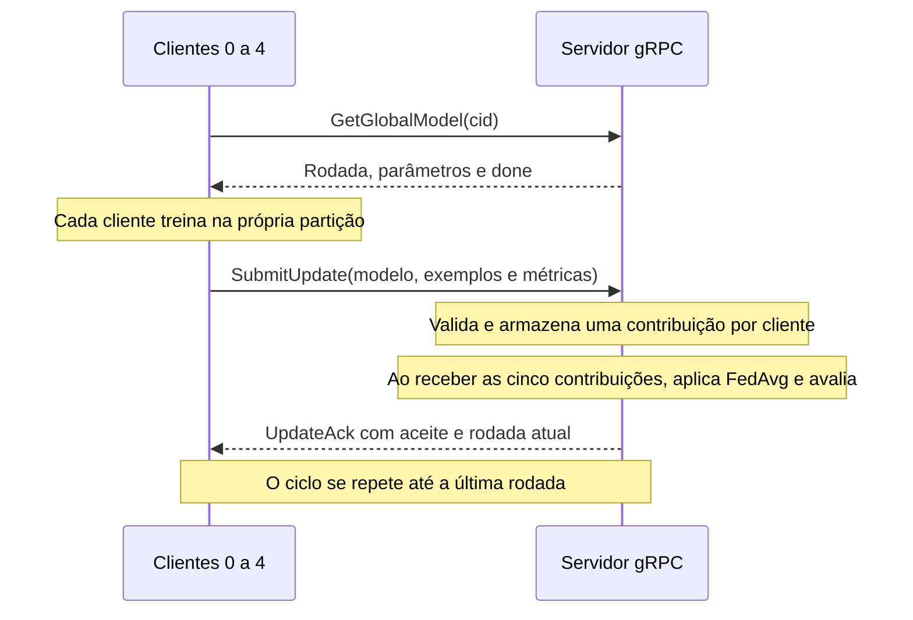

# Trabalho 1 — Aprendizagem Federada com gRPC

Trabalho da disciplina de Sistemas Distribuídos. O projeto implementa um servidor
coordenador e clientes Python que treinam um modelo de classificação de flores
sobre partições do dataset Iris. A comunicação ocorre por gRPC, e o servidor
combina os parâmetros locais com o algoritmo FedAvg.

A configuração Docker executa **um servidor, cinco clientes e cinco rodadas**.
A implementação está na branch `develop/trabalho1`; a `main` preserva o estado
inicial do material e da análise.

## Sumário

1. [Como executar](#capítulo-1--como-executar)
2. [Objetivo e origem do trabalho](#capítulo-2--objetivo-e-origem-do-trabalho)
3. [Organização do projeto](#capítulo-3--organização-do-projeto)
4. [Dados e modelo de aprendizado](#capítulo-4--dados-e-modelo-de-aprendizado)
5. [Arquitetura e ciclo de uma rodada](#capítulo-5--arquitetura-e-ciclo-de-uma-rodada)
6. [Contrato gRPC e serialização](#capítulo-6--contrato-grpc-e-serialização)
7. [Funcionamento do cliente](#capítulo-7--funcionamento-do-cliente)
8. [Funcionamento do servidor](#capítulo-8--funcionamento-do-servidor)
9. [Agregação e avaliação](#capítulo-9--agregação-e-avaliação)
10. [Como a implementação foi feita](#capítulo-10--como-a-implementação-foi-feita)
11. [Ambiente Docker](#capítulo-11--ambiente-docker)
12. [Testes e resultados](#capítulo-12--testes-e-resultados)
13. [Execução sem Docker](#capítulo-13--execução-sem-docker)
14. [Problemas comuns e limites](#capítulo-14--problemas-comuns-e-limites)
15. [Regras e referências](#capítulo-15--regras-e-referências)

## Capítulo 1 — Como executar

### 1.1 Requisitos

Instale Docker Engine ou Docker Desktop com Docker Compose v2. O usuário precisa
ter acesso ao daemon Docker. É necessário acesso à internet para baixar a imagem,
as bibliotecas e, na primeira execução, o dataset.

Confira as ferramentas:

```bash
docker --version
docker compose version
docker info
```

### 1.2 Baixar a implementação

```bash
git clone --branch develop/trabalho1 https://github.com/RodriguessLucas/Sistemas-Distribuidos_trabalho-1.git
cd Sistemas-Distribuidos_trabalho-1
```

Se o repositório já estiver na máquina, abra um terminal na raiz dele e selecione
a branch com a implementação:

```bash
git switch develop/trabalho1
git pull --ff-only
```

A raiz é a pasta que contém `Dockerfile`, `compose.yaml` e este README.
No workspace usado no desenvolvimento, basta abrir o terminal nessa pasta;
não é necessário clonar novamente.

### 1.3 Construir, testar e executar

Execute na raiz:

```bash
docker build -t trabalho1:local .
docker compose --profile test run --rm tests
docker compose up --no-build
```

O primeiro comando constrói a imagem, instala as dependências e gera os arquivos
Python do protobuf. O segundo executa os testes e remove o contêiner de teste.
O terceiro inicia a preparação dos dados, o servidor e os cinco clientes.

Os logs aparecem no terminal. Cada rodada termina quando os cinco clientes
entregam suas atualizações. Após a quinta rodada, o servidor encerra e os clientes
finalizam suas consultas. Não existe uma página web para abrir no navegador:
a saída deste projeto é apresentada no terminal.

Um trecho esperado da saída é:

```text
[Servidor] Rodada 5/5 consolidada
  Treino médio local - loss: ... | acc: ...
  Modelo global - loss: ... | acc: ...
[Servidor] Todas as rodadas foram concluídas. Encerrando servidor gRPC...
[Servidor] Servidor encerrado com sucesso.
```

Depois que os serviços terminarem, confira:

```bash
docker compose ps -a
```

O resultado esperado é `Exited (0)` para `dataset`, `server` e `client-0` até
`client-4`. Uma mensagem isolada de indisponibilidade em um cliente não basta
para confirmar sucesso: confira também as cinco consolidações do servidor.

### 1.4 Executar em segundo plano

Como alternativa ao comando de execução em primeiro plano:

```bash
docker compose up --no-build -d
docker compose logs -f
```

Nesse modo, `Ctrl+C` encerra apenas o acompanhamento de logs. Para interromper
uma execução em andamento e remover os contêineres e a rede:

```bash
docker compose down
```

Esse comando preserva o volume com o cache do Iris. Para uma nova execução,
use novamente `docker compose up --no-build`.

Depois de alterar código, testes ou dependências, reconstrua a imagem antes de
executar. Não há montagem automática dos arquivos locais dentro dos contêineres.

## Capítulo 2 — Objetivo e origem do trabalho

O material do professor contém uma simulação sequencial pronta e um kit gRPC
propositalmente incompleto. A atividade consiste em completar os TODOs do cliente
e do servidor, mantendo a arquitetura fornecida e usando os testes como guia.

A aprendizagem federada distribui o treinamento: cada cliente ajusta o modelo com
sua própria partição, enquanto o servidor coordena as rodadas e agrega os
parâmetros. Neste kit, os exemplos de treino não são enviados nas mensagens RPC;
os clientes enviam pesos, interceptos, quantidade de exemplos e métricas.

| Recurso | Origem e finalidade |
| --- | --- |
| Código inicial | `codigo.zip`, disponibilizado pelo professor no SIGAA e extraído em `codigo/` |
| Enunciado | [trabalho-1.pdf](trabalho-1.pdf) |
| Guia de implementação | [README original do kit](codigo/start/README.md) |
| Dados | [hitorilabs/iris no Hugging Face](https://huggingface.co/datasets/hitorilabs/iris) |
| Referência de aula | [What is Federated Learning?](https://flower.ai/docs/framework/tutorial-series-what-is-federated-learning.html) |
| Exemplo relacionado | [Quickstart scikit-learn do Flower](https://flower.ai/docs/framework/tutorial-quickstart-scikitlearn.html) |

O projeto utiliza **Flower Datasets** para carregar e particionar os dados.
A coordenação das rodadas e o transporte gRPC são implementados no próprio kit.
Não é necessário clonar um projeto adicional nem substituir o código pelo
framework Flower completo.

## Capítulo 3 — Organização do projeto

```text
.
├── README.md
├── AGENTS.md
├── ANALISE.md
├── Dockerfile
├── compose.yaml
├── requirements-docker.txt
├── .dockerignore
├── .gitignore
├── trabalho-1.pdf
├── codigo.zip
├── skills/
│   ├── sd-criterios-aceitacao/SKILL.md
│   └── sd-padrao-codigo/SKILL.md
└── codigo/
    ├── pyproject.toml
    ├── fl_sim_manual.py
    └── start/
        ├── README.md
        ├── common_fl.py
        ├── federated.proto
        ├── student_fl_client_grpc.py
        ├── student_fl_server_grpc.py
        └── tests/
            ├── test_01_client_serialization.py
            ├── test_02_client_loop.py
            ├── test_03_server_serialization_and_get.py
            ├── test_04_server_validation.py
            ├── test_05_server_submit_and_consolidate.py
            ├── test_06_client_round_control.py
            ├── utils.py
            └── __init__.py
```

| Arquivo | Responsabilidade |
| --- | --- |
| `fl_sim_manual.py` | Demonstra o ciclo federado de forma sequencial, dentro de um processo |
| `common_fl.py` | Carrega dados, cria o modelo, treina, agrega e avalia |
| `federated.proto` | Define mensagens e operações RPC compartilhadas |
| `student_fl_client_grpc.py` | Consulta o servidor, treina localmente e envia atualizações |
| `student_fl_server_grpc.py` | Mantém o estado global, recebe atualizações e consolida rodadas |
| `Dockerfile` | Prepara a imagem Python e gera o código protobuf |
| `compose.yaml` | Organiza os serviços, a rede, as dependências e o cache |
| `requirements-docker.txt` | Fixa as versões das dependências principais do ambiente Docker |
| `ANALISE.md` | Registra o diagnóstico inicial, anterior à implementação |
| `AGENTS.md` e `skills/` | Registram as regras de implementação e os critérios de aceitação |

`federated_pb2.py` e `federated_pb2_grpc.py` são gerados a partir de
`federated.proto`. Eles não são versionados; o build os cria dentro da imagem.

## Capítulo 4 — Dados e modelo de aprendizado

### 4.1 Dataset Iris

O Iris possui 150 exemplos, três classes de flores e quatro atributos numéricos.
O código usa esta ordem de atributos:

1. `petal_length`: comprimento da pétala;
2. `petal_width`: largura da pétala;
3. `sepal_length`: comprimento da sépala;
4. `sepal_width`: largura da sépala.

O alvo é `species`. Os atributos são convertidos para arrays NumPy `float64`.
O `IidPartitioner` divide o dataset entre os clientes. Em cada partição, o código
reserva aproximadamente 80% para treinamento e 20% para teste.

Com cinco partições iguais, cada cliente tem 30 exemplos: 24 de treino e seis de
teste. O conjunto global de avaliação reúne os 30 exemplos de teste.

### 4.2 Inicialização do modelo

`create_model_template` cria uma `LogisticRegression` com:

| Parâmetro | Valor | Papel |
| --- | --- | --- |
| `penalty` | `l2` | Regularização do modelo |
| `max_iter` | `1` | Mantém cada ajuste local curto |
| `warm_start` | `True` | Permite continuar o ajuste a partir dos parâmetros recebidos |
| `solver` | `saga` | Algoritmo de otimização escolhido no material |
| `random_state` | `42` | Controla a aleatoriedade do otimizador |

O scikit-learn precisa de um ajuste inicial para criar atributos internos, como
`classes_`, `coef_` e `intercept_`. O kit seleciona um exemplo de cada classe para
esse ajuste e depois zera pesos e interceptos. Assim, os participantes iniciam
com a mesma estrutura e parâmetros numéricos zerados.

### 4.3 Funções compartilhadas

| Função de `common_fl.py` | Comportamento |
| --- | --- |
| `build_federated_dataset` | Configura a origem do Iris e o particionamento IID |
| `load_seed_data` | Seleciona uma amostra por classe para inicialização |
| `load_client_partition` | Retorna treino e teste de um cliente pelo seu ID |
| `load_all_test_sets` | Reúne as partições de teste para avaliação global |
| `create_model_template` | Inicializa a regressão logística e zera os parâmetros |
| `get_model_params` | Extrai cópias de coeficientes e interceptos |
| `set_model_params` | Aplica parâmetros recebidos a um modelo |
| `local_train` | Copia o modelo, aplica parâmetros globais, treina e calcula métricas locais |
| `aggregate_fedavg` | Combina os parâmetros locais por média ponderada |
| `evaluate_global_model` | Calcula perda e acurácia do modelo agregado |

Se uma partição de treino tiver menos de duas classes, `local_train` não executa
`fit`; mantém os parâmetros recebidos e ainda calcula as métricas. Essa proteção
já fazia parte do código original.

## Capítulo 5 — Arquitetura e ciclo de uma rodada



O sistema é síncrono por rodada. Clientes podem terminar o treino em momentos
diferentes, mas o servidor só consolida quando recebe todas as contribuições
esperadas. Um cliente que já teve sua atualização aceita consulta novamente e
aguarda se o servidor ainda não abriu uma rodada nova.

A rodada inicial é `1`. Depois da quinta consolidação, `current_round` passa a
`6`; como `6 > total_rounds`, o treinamento está concluído.

Docker fornece processos e uma rede entre os contêineres. A sincronização das
rodadas continua sendo responsabilidade do código Python e das mensagens RPC.

## Capítulo 6 — Contrato gRPC e serialização

### 6.1 Operações

O serviço `FederatedLearning` oferece duas RPCs unárias:

| Operação | Entrada | Saída |
| --- | --- | --- |
| `GetGlobalModel` | `ClientHello` | `GlobalModel` |
| `SubmitUpdate` | `ClientUpdate` | `UpdateAck` |

### 6.2 Mensagens

| Mensagem | Campos e significado |
| --- | --- |
| `ClientHello` | `cid`: identificador do cliente que consulta o servidor |
| `ModelParameters` | `coef_values`: pesos achatados; `coef_shape`: dimensões; `intercept_values`: interceptos |
| `GlobalModel` | `round`, `total_rounds`, `done`, `message` e `model` |
| `ClientUpdate` | `cid`, `round`, `num_examples`, `train_loss`, `train_acc` e `model` |
| `UpdateAck` | `accepted`, `message` e `server_round` |

### 6.3 Conversão dos parâmetros

O código representa o estado do modelo como `[coef, intercept]`. Para transmitir
a matriz `coef`, a serialização usa `ravel().tolist()` e guarda seu formato em
`coef_shape`. O receptor reconstrói um array `float64` e aplica `reshape`.
O vetor de interceptos também é convertido entre lista protobuf e array NumPy.

Por exemplo, a matriz `[[1, 2], [3, 4]]` é transmitida com valores
`[1, 2, 3, 4]` e formato `[2, 2]`. Preservar ambos permite recuperar a matriz
original. A mesma representação é usada por cliente e servidor.

## Capítulo 7 — Funcionamento do cliente

### 7.1 Funções implementadas

| Função | Responsabilidade |
| --- | --- |
| `params_from_proto` | Reconstrói os arrays recebidos do servidor |
| `params_to_proto` | Serializa os parâmetros treinados |
| `build_client_update` | Monta a mensagem com identificação, rodada, modelo e métricas |
| `run_client` | Controla consulta, espera, treinamento, envio e encerramento |

`should_wait` já estava fornecida: retorna verdadeiro quando a rodada recebida
é menor ou igual à última rodada concluída pelo cliente.

### 7.2 Laço principal

O cliente carrega sua partição e cria o modelo-base uma vez. Abre um canal gRPC
e, a cada iteração:

1. solicita o modelo global com seu `cid`;
2. encerra se a resposta indicar `done=True`;
3. aguarda `poll_interval` se já concluiu aquela rodada;
4. reconstrói os parâmetros globais;
5. executa `local_train` com seus dados de treino;
6. monta e envia um `ClientUpdate`;
7. registra `completed_round` somente se `ack.accepted=True`;
8. imprime as métricas ou o motivo da recusa e espera antes da próxima consulta.

Uma recusa não marca a rodada como concluída. O cliente continua seguindo o
estado informado pelo servidor nas próximas consultas.

### 7.3 Erros e desligamento

O servidor pode desligar antes de todos os clientes consultarem `done=True`.
O cliente trata `UNAVAILABLE` na consulta e no envio, informa que o servidor está
indisponível ou finalizado e encerra. Isso não declara, por si só, sucesso global.

A execução real também revelou `CANCELLED` em consultas feitas durante o
desligamento. Quando a última rodada do cliente já foi aceita, ele espera e
consulta novamente para obter o estado final ou a indisponibilidade. Esse
tratamento não é aplicado a cancelamentos em rodadas anteriores. Outros erros
RPC são propagados para não esconder falhas.

### 7.4 Argumentos do cliente

| Argumento | Padrão | Finalidade |
| --- | --- | --- |
| `--cid` | Obrigatório | ID da partição do cliente |
| `--server-address` | `127.0.0.1:50051` | Endereço do servidor |
| `--num-clients` | `5` | Quantidade de partições do dataset |
| `--poll-interval` | `1.0` | Intervalo em segundos entre consultas |
| `--local-epochs` | `1` | Número de ajustes locais em cada rodada |

## Capítulo 8 — Funcionamento do servidor

### 8.1 Estado compartilhado

`FederatedLearningServicer` mantém:

| Atributo | Papel |
| --- | --- |
| `num_clients` | Número de contribuições esperadas por rodada |
| `total_rounds` | Número de rodadas configuradas |
| `current_round` | Rodada que recebe atualizações, iniciada em 1 |
| `global_params` | Parâmetros do modelo global atual |
| `model_template` | Estrutura do modelo usada na avaliação |
| `received_updates` | Atualizações da rodada, indexadas pelo ID do cliente |
| `lock` | Exclusão mútua para consultar e modificar o estado |
| `training_finished` | Evento que libera o encerramento do servidor |
| `X_test_global`, `y_test_global` | Conjunto de avaliação reunido pelo kit |

### 8.2 Consulta do modelo

`GetGlobalModel` acessa o estado sob o lock e responde com modelo, rodada, total,
mensagem e indicador de conclusão. Mesmo depois do fim, uma resposta que consiga
ser atendida continua contendo rodada e modelo.

### 8.3 Validação da atualização

`_validate_update` aplica as regras originais nesta ordem:

1. recusa se o treinamento terminou;
2. recusa se a rodada recebida é diferente da atual;
3. recusa se o cliente já contribuiu naquela rodada;
4. aceita com a mensagem `OK` nos demais casos.

As mensagens de recusa identificam o motivo. Uma atualização recusada não entra
no buffer e não dispara agregação.

### 8.4 Recebimento e consolidação

`SubmitUpdate` valida, converte o modelo recebido para NumPy e armazena os
parâmetros, quantidade de exemplos e métricas em `received_updates[cid]`.
Depois chama `_consolidate_round_if_ready` e devolve a confirmação.

A consolidação ocorre somente quando o tamanho do buffer é igual a
`num_clients`. Ela agrega os modelos, avalia o resultado, calcula as médias das
métricas locais, imprime os resultados, limpa o buffer e avança a rodada.
Se ultrapassou o limite de rodadas, sinaliza `training_finished`.

A confirmação devolve a rodada atual após essa operação. Assim, o cliente que
fecha uma rodada pode receber um `server_round` já incrementado.

### 8.5 Concorrência e término

O gRPC atende requisições com um `ThreadPoolExecutor` de até dez workers.
`GetGlobalModel` e `SubmitUpdate` usam o mesmo `threading.Lock` para evitar
leitura de um estado parcialmente atualizado e modificações simultâneas no buffer.
Os auxiliares chamados dentro de `SubmitUpdate` não adquirem novamente esse lock,
pois ele não é reentrante.

A função `serve` aguarda `training_finished`, solicita `server.stop(grace=2)`
e espera o desligamento. Essa estrutura já estava fornecida no material.

| Argumento do servidor | Padrão | Finalidade |
| --- | --- | --- |
| `--host` | `127.0.0.1` | Interface de escuta |
| `--port` | `50051` | Porta gRPC |
| `--num-clients` | `5` | Clientes esperados por rodada |
| `--rounds` | `5` | Quantidade total de rodadas |

## Capítulo 9 — Agregação e avaliação

### 9.1 FedAvg

Se o cliente `k` utiliza `n_k` exemplos e devolve parâmetros `θ_k`, o servidor
calcula, elemento a elemento:

```text
N = soma de todos os n_k
θ_global = soma de (n_k / N) × θ_k
```

A mesma ponderação é aplicada aos coeficientes e aos interceptos. Um cliente
com 10 exemplos contribui com peso 0,25 se o outro tem 30 exemplos e o total é 40.
Com as cinco partições iguais da configuração padrão, os pesos são iguais.

### 9.2 Métricas

| Métrica | Interpretação |
| --- | --- |
| `train_loss` | Perda logarítmica calculada nos dados locais de treino |
| `train_acc` | Proporção de acertos nos dados locais de treino |
| Loss global | Perda do modelo agregado sobre os testes reunidos |
| Acurácia global | Proporção de acertos do modelo agregado nos testes reunidos |

Os parâmetros do FedAvg são ponderados pelo número de exemplos. As médias de
`train_loss` e `train_acc` impressas pelo servidor são médias aritméticas entre
os clientes, conforme o guia original.

Menor perda e maior acurácia costumam indicar melhor desempenho, mas o trabalho
não impõe acurácia mínima nem melhora obrigatória em toda rodada. As métricas de
treino e teste usam conjuntos diferentes e não devem ser confundidas.

## Capítulo 10 — Como a implementação foi feita

O diagnóstico inicial identificou dez funções incompletas: quatro no cliente e
seis no servidor. O laço do cliente continha apenas comentários, impedindo até
a importação do arquivo por erro de sintaxe. Os arquivos protobuf também ainda
precisavam ser gerados.

A implementação completou a conversão entre protobuf e NumPy, a construção de
atualizações, a disponibilização do modelo global, a validação de contribuições,
a consolidação das rodadas e o laço do cliente. A preparação do ambiente passou
a gerar os arquivos protobuf e incluir `grpcio` e `grpcio-tools`.

Foram preservados o contrato `federated.proto`, as funções de `common_fl.py`, a
simulação manual, o `pyproject.toml` e os 15 testes originais. O ambiente Docker
usa um arquivo adicional de dependências para não modificar o material original.

Depois dos testes unitários, a execução com processos reais revelou a consulta
cancelada durante o desligamento. O caso foi corrigido no cliente, coberto com
testes adicionais e verificado em uma nova execução completa.

O histórico separa o material inicial na `main`, a infraestrutura e as regras em
um commit de desenvolvimento e a implementação com sua validação no seguinte.
Os hashes locais anteriores à publicação pelo conector foram preservados em
tags locais de backup; o conteúdo das branches locais foi conferido com o remoto.

## Capítulo 11 — Ambiente Docker

### 11.1 Imagem

O `Dockerfile` usa a imagem oficial `python:3.12-slim` do Docker Hub. Python 3.12
atende ao `requires-python >=3.9` do projeto. O PDF recomenda um ambiente 3.14;
a configuração usada para a validação foi 3.12.

O build instala `requirements-docker.txt`, copia `codigo/` e executa o compilador
protobuf em `/app/codigo/start`. As dependências principais têm versões fixadas;
as transitivas continuam sendo resolvidas pelo pip. A imagem base usa uma tag,
sem fixação por digest, portanto o ambiente não é integralmente imutável.

| Biblioteca | Uso |
| --- | --- |
| `grpcio` | Comunicação RPC em tempo de execução |
| `grpcio-tools` | Geração de código Python a partir do `.proto` |
| `flwr-datasets` | Download e particionamento do dataset |
| `scikit-learn` | Regressão logística e métricas |
| `numpy` | Arrays, conversões e agregação |
| `pandas` | Manipulação tabular das partições |

### 11.2 Serviços do Compose

| Serviço | Papel e condição de execução |
| --- | --- |
| `dataset` | Prepara o Iris e encerra com sucesso antes de iniciar o servidor |
| `server` | Aguarda os dados e expõe o serviço gRPC |
| `client-0` a `client-4` | Aguardam o healthcheck do servidor e usam IDs distintos |
| `tests` | Executa a suíte quando solicitado com o profile `test` |
| `simulation` | Executa o programa sequencial com o profile `simulation` |

O healthcheck confirma que o canal gRPC consegue se conectar. Ele não verifica
acurácia nem conclusão das rodadas. Os clientes acessam `server:50051` pela rede
interna. A porta publicada no host é `127.0.0.1:50051`.

O volume `huggingface-cache` é montado em `/cache/huggingface`, endereço definido
por `HF_HOME`. Isso permite reutilizar o dataset entre serviços e execuções.

### 11.3 Outros comandos úteis

Consultar somente os logs dos participantes:

```bash
docker compose logs server client-0 client-1 client-2 client-3 client-4
```

Executar a simulação sequencial original:

```bash
docker compose --profile simulation run --rm simulation
```

Essa simulação é outro programa: sua configuração original usa cinco clientes,
dez rodadas e uma época local. O Compose distribuído usa cinco rodadas.

Validar a configuração do Compose:

```bash
docker compose config --quiet
```

Para mudar a quantidade de clientes no Compose, ajuste o número no servidor e
em todos os clientes, a preparação do dataset e a lista de serviços com IDs de
`0` até `num_clients - 1`. Para mudar rodadas, ajuste `--rounds` no servidor.
Os clientes recebem o total de rodadas nas respostas RPC.

## Capítulo 12 — Testes e resultados

### 12.1 Cobertura da suíte

| Arquivo | Testes | Comportamento verificado |
| --- | --- | --- |
| `test_01_client_serialization.py` | 3 | Conversões e construção de `ClientUpdate` |
| `test_02_client_loop.py` | 2 | Espera por rodada e processamento de uma rodada |
| `test_03_server_serialization_and_get.py` | 4 | Conversões, resposta global e indicador de fim |
| `test_04_server_validation.py` | 4 | Aceite e recusas por término, rodada ou duplicação |
| `test_05_server_submit_and_consolidate.py` | 2 | Armazenamento, consolidação e recusa |
| `test_06_client_round_control.py` | 7 | Polling, recusa, indisponibilidade, cancelamento e propagação de erros |
| **Total** | **22** | **15 originais e 7 adicionais** |

Executar a suíte no Docker:

```bash
docker compose --profile test run --rm tests
```

Executar apenas os testes adicionais:

```bash
docker compose --profile test run --rm tests python -m unittest tests.test_06_client_round_control -v
```

Os testes usam mocks para isolar componentes. Sua aprovação não prova sozinha
que a comunicação real ou o download dos dados funciona. Por isso também foi
executado o cenário distribuído completo.

### 12.2 Validação realizada em 28/10/2026

| Verificação | Resultado observado |
| --- | --- |
| Build da imagem | Concluído, incluindo geração protobuf |
| Suíte unitária | 22 testes aprovados |
| Download do Iris | Concluído |
| Execução distribuída | Cinco clientes e cinco rodadas consolidadas |
| Código de saída | 0 para preparação, servidor e todos os clientes |
| Loss global final | 0,4877 |
| Acurácia global final | 0,9333, aproximadamente 93,33% |

As métricas são o resultado daquela execução, não uma garantia para qualquer
versão de biblioteca ou configuração. O enunciado não define uma meta numérica.
A ampliação deste README não modifica a implementação validada.

## Capítulo 13 — Execução sem Docker

O Docker é o caminho usado na validação. Para executar diretamente no host,
prepare um ambiente Python compatível e instale as mesmas dependências principais.
Os comandos abaixo usam shell Linux/macOS, a partir da raiz:

```bash
python3 -m venv .venv
source .venv/bin/activate
python -m pip install -r requirements-docker.txt
cd codigo/start
python -m grpc_tools.protoc -I. --python_out=. --grpc_python_out=. federated.proto
python -m unittest discover -s tests -v
```

No PowerShell, a ativação equivalente é `.venv\Scripts\Activate.ps1`.
A geração protobuf deve ocorrer antes de importar cliente e servidor.

Para um cenário pequeno, abra três terminais com o mesmo ambiente ativado e
o diretório atual em `codigo/start`. No primeiro:

```bash
python student_fl_server_grpc.py --num-clients 2 --rounds 2
```

No segundo:

```bash
python student_fl_client_grpc.py --cid 0 --num-clients 2
```

No terceiro:

```bash
python student_fl_client_grpc.py --cid 1 --num-clients 2
```

Inicie o servidor antes dos clientes e aguarde a mensagem de que ele está ouvindo.
Esse caminho manual não recebeu uma validação independente nesta sessão; a
execução real validada ocorreu nos contêineres.

## Capítulo 14 — Problemas comuns e limites

### 14.1 Diagnóstico de execução

| Sintoma | O que conferir |
| --- | --- |
| Permissão negada no Docker | Acesso do usuário ao daemon; `docker info` deve funcionar |
| `docker compose build` falha com Buildx | Instalação do plugin Buildx; no ambiente inicial `docker build -t trabalho1:local .` usou o builder legado como alternativa |
| Imagem `trabalho1:local` ausente | Execute o build antes de usar `--no-build` |
| Rodada não avança | Todos os clientes precisam executar com IDs distintos e o mesmo `--num-clients` |
| Porta 50051 ocupada | Verifique outro servidor no host ou ajuste o mapeamento de porta do Compose |
| Imports de `federated_pb2` falham | Gere os arquivos do `.proto` no diretório correto |
| Alteração local não aparece | Reconstrua a imagem; não há bind mount de código |
| Download demora ou falha | Acesso ao Hugging Face e disponibilidade do cache |
| Cliente informa indisponibilidade | Verifique se o servidor consolidou as rodadas e encerrou, ou se falhou antes |
| Aviso de dataset não testado pelo Flower | O ID `hitorilabs/iris` é o original do trabalho e funcionou na execução validada; não foi substituído |

Não use `--abort-on-container-exit` para esse Compose: o serviço `dataset`
encerra normalmente antes de o treinamento começar. Os participantes também
podem encerrar em momentos diferentes no fim da execução.

### 14.2 Limitações do sistema didático

O servidor carrega os testes de todas as partições para avaliar o modelo, e os
participantes usam dados-semente para inicialização. Embora as RPCs não
transportem exemplos de treino, essa arquitetura não representa isolamento
completo dos dados entre organizações.

O transporte usa canais sem TLS. Não há autenticação, privacidade diferencial,
agregação segura, checkpoint persistente nem recuperação de clientes ausentes.
O estado das rodadas fica na memória do servidor. Se um cliente não contribuir,
o servidor aguarda, pois não existe timeout da rodada ou seleção de subconjunto.

As validações implementadas são as exigidas no material. Elas não constituem uma
validação completa contra entradas arbitrárias, como IDs indevidos ou parâmetros
malformados. Essas limitações delimitam o protótipo e não foram transformadas em
novas exigências nem usadas para mudar as regras originais.

## Capítulo 15 — Regras e referências

### 15.1 Regras do projeto

A regra universal está em [AGENTS.md](AGENTS.md): **nenhuma regra original do
código ou material pode ser alterada, removida, enfraquecida ou contornada**.
A implementação deve completar o trabalho preservando os contratos e a lógica.

O código novo fica sem comentários explicativos e docstrings didáticas. As
explicações ficam na documentação. Comentários originais em trechos intocados e
cabeçalhos do código protobuf gerado são preservados. Os testes originais não
podem ser adaptados para esconder erros da implementação.

As skills locais detalham [critérios de aceitação](skills/sd-criterios-aceitacao/SKILL.md)
e [padrão de código](skills/sd-padrao-codigo/SKILL.md). O
[diagnóstico inicial](ANALISE.md) documenta as pendências encontradas antes do
início da implementação.

### 15.2 Referências

- [Enunciado do professor](trabalho-1.pdf).
- [Guia original de implementação](codigo/start/README.md).
- [Contrato protobuf do trabalho](codigo/start/federated.proto).
- [Flower — What is Federated Learning?](https://flower.ai/docs/framework/tutorial-series-what-is-federated-learning.html).
- [Flower — Quickstart scikit-learn](https://flower.ai/docs/framework/tutorial-quickstart-scikitlearn.html).
- [Dataset Iris usado no código](https://huggingface.co/datasets/hitorilabs/iris).
